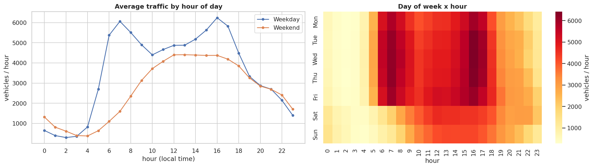
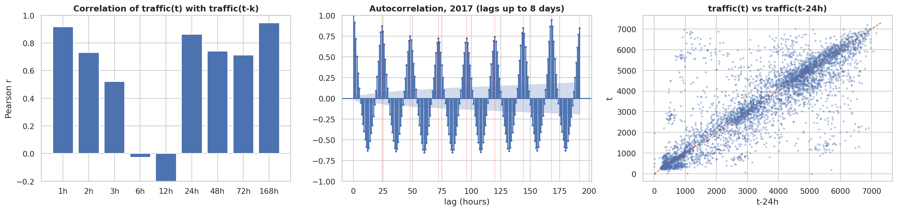
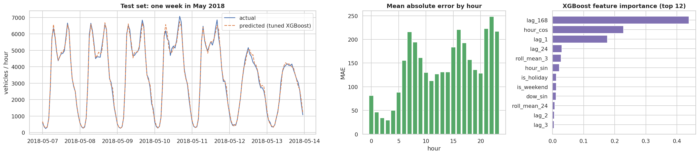

# Time-Series Pipeline - I-94 Metro Interstate Traffic Volume

Group assignment: preprocessing, databases (MySQL + MongoDB), CRUD API and a forecast script built on one time-series dataset.

**Dataset:** [Metro Interstate Traffic Volume](https://archive.ics.uci.edu/dataset/492/metro+interstate+traffic+volume) (UCI, CC BY 4.0) - hourly westbound I-94 traffic volume (MN DoT station 301) with weather and holiday information, Oct 2012 - Sep 2018 (48,204 rows).

**Forecasting problem:** predict `traffic_volume` (vehicles/hour) at hour *t* from traffic up to *t-1* plus weather/calendar information for hour *t*.

## Repository structure
```
.
├── data/
│   ├── raw/Metro_Interstate_Traffic_Volume.csv   # original data
│   └── processed/traffic_for_db.csv              # cleaned rows ready to load into MySQL/MongoDB
│       processed/traffic_hourly_clean.csv        # full hourly grid incl. gaps (used by the notebook)
├── notebooks/01_eda_and_modeling.ipynb           # Task 1: EDA, 6 analytical questions, model experiments
├── src/preprocessing.py                          # clean() + add_features(), shared by Task 1 and Task 4
├── models/                                       # trained model + metadata (feature list, params, metrics)
├── outputs/                                      # figures, experiment_table.csv, tuning_trials.csv
├── sql/            (Task 2)   schema scripts + queries
├── mongo/          (Task 2)   collection design + queries
├── api/            (Task 3)   CRUD + time-series endpoints
├── scripts/        (Task 4)   forecast script
└── requirements.txt
```
Folders marked with a task number are added as those tasks are completed.

## Reproduce Task 1
```bash
python -m venv .venv && source .venv/bin/activate
pip install -r requirements.txt
cd notebooks && jupyter nbconvert --to notebook --execute --inplace 01_eda_and_modeling.ipynb
```
(The full run takes about 5-6 minutes, mostly the Random Forest cross-validation.)

## Key preprocessing decisions
| Problem | Treatment |
|---|---|
| 7,629 rows share a timestamp (one per weather report; identical traffic) | aggregate to one row per hour |
| temp = 0 K, rain = 9,831 mm (sensor errors) | set to NaN |
| 22.8% of hours missing (incl. a 10-month outage, Aug 2014 - Jun 2015) | reindex to a full hourly grid; interpolate only gaps <= 6 h; leave longer gaps missing |
| `holiday` is NaN on 99.9% of rows | binary `is_holiday` for the whole day |

## Task 1 results (test set: Jan-Sep 2018)
| Experiment | Model | CV RMSE | Test RMSE | Test MAE | Test R2 |
|---|---|---|---|---|---|
| Ref | Seasonal naive (t-168 h) | - | 647.2 | 338.6 | 0.893 |
| 1 | Linear Regression | 413.2 | 397.6 | 280.1 | 0.959 |
| 2 | Random Forest (default) | 279.6 | 235.9 | 147.5 | 0.986 |
| 3 | XGBoost (default) | 278.1 | 235.1 | 150.4 | 0.986 |
| **4** | **XGBoost (tuned, selected)** | **261.3** | **222.3** | **141.6** | **0.987** |
| 5 | Exp 4 without lag/rolling features | 465.8 | 372.7 | 228.7 | 0.964 |

## Key figures




## Team contributions
| Member | Components |
|---|---|
| _Denyse ishimirwe_ | Task 1 - EDA, analytical questions, modelling |
| _name_ | _fill in_ |
| _name_ | _fill in_ |
