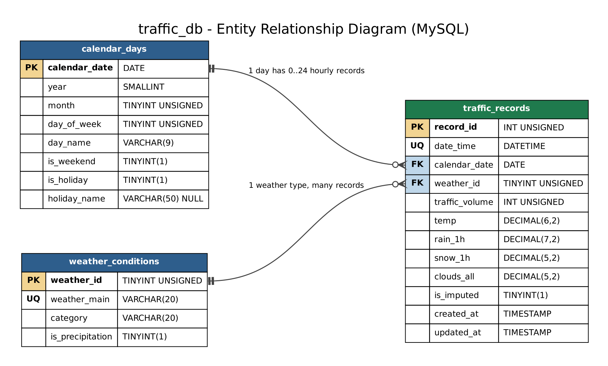

# Task 2 - Database design (MySQL + MongoDB)

Both databases hold the same data: `data/processed/traffic_for_db.csv` from Task 1
(43,623 clean hourly rows, 2012-10-02 09:00 to 2018-09-30 23:00, with gaps).

## Quick start (rebuild both databases from scratch)
```bash
pip install -r requirements.txt
cp .env.example .env                 # then put your own MySQL password / Mongo URI in .env

mysql -u root -p < sql/01_create_schema.sql      # create MySQL tables (+ 11 weather rows)
python sql/load_mysql.py                         # load 1,860 days + 43,623 hours
python sql/run_queries.py                        # run 7 queries -> sql/query_results.md

python mongo/setup_and_load.py                   # create collections, validator, indexes, load data
python mongo/queries.py                          # run 7 queries -> mongo/query_results.md
```
Requires MySQL 8.0+ and MongoDB 5.0+ (window functions / `$setWindowFields`, `$dateTrunc`).

---

## 1. Relational design (MySQL) - `sql/`



| Table | Rows | Role | Key points |
|---|---|---|---|
| `weather_conditions` | 11 | lookup (dimension) | `weather_main` is UNIQUE; adds `category` and `is_precipitation` |
| `calendar_days` | 1,860 | date dimension | PK `calendar_date`; weekday, weekend, `is_holiday`, `holiday_name` |
| `traffic_records` | 43,623 | fact table (the time series) | UNIQUE `date_time`; FKs to both dimensions; CHECK constraints on values |
| `v_traffic_records` | view | flat API shape | joins the 3 tables back into the agreed JSON field names |

**Why this design**
* **3NF / no repetition** - the 11 weather labels were repeated 43,623 times and the holiday
  flag 24 times per day. Moving them to lookup tables removes that redundancy, so a fact like
  "2018-09-03 is Labor Day" is stored once and can never disagree with itself.
* **Time-series friendly** - `date_time` has a UNIQUE index (one row per hour), which is exactly
  what the "latest record" (`ORDER BY date_time DESC LIMIT 1`) and "date range"
  (`WHERE date_time BETWEEN ...`) queries use, so neither scans the table.
* **Data quality enforced by the database** - foreign keys stop unknown weather types or dates,
  CHECK constraints reject impossible values (temp outside 200-340 K, clouds > 100 %, negative rain),
  the same sensor errors Task 1 had to clean.
* **Relationships** - one `calendar_days` row has 0..24 `traffic_records` (gaps are allowed);
  one `weather_conditions` row has many `traffic_records`.

Files: `01_create_schema.sql` (DDL), `load_mysql.py` (loader), `02_queries.sql` + `run_queries.py`
(queries), `query_results.md` (results), `erd.dot` / `erd.png` (diagram).

## 2. Document design (MongoDB) - `mongo/`

| Collection | Docs | Design |
|---|---|---|
| `traffic_readings` | 43,623 | one document per hour; weather and calendar **embedded** as sub-documents |
| `daily_summaries` | 1,860 | one document per day, built by an aggregation pipeline (`$group` + `$merge`); 24 hourly values stored in an array (bucket pattern) |

**Why this design**
* MongoDB is designed around how data is read. Weather and calendar are always read with the
  traffic value, so they are embedded (no joins needed), unlike MySQL where they are normalised.
* `daily_summaries` pre-computes daily totals so day-level questions (e.g. holidays) read
  1,860 small documents instead of grouping 43,623 every time.
* A `$jsonSchema` **validator** makes MongoDB reject bad documents (missing fields, negative
  traffic, unknown weather type) - tested: inserting `traffic_volume: -5` is rejected.
* **Indexes**: unique `date_time` (latest / range queries, no duplicate hours),
  `weather.weather_main + date_time`, `calendar.is_holiday`; `daily_summaries.date`.

Sample documents: `mongo/sample_documents.json`. Example `traffic_readings` document:
```json
{
  "date_time": {"$date": "2018-09-30T23:00:00Z"},
  "traffic_volume": 954,
  "weather":  {"weather_main": "Clouds", "category": "cloudy", "temp": 282.12,
               "rain_1h": 0.0, "snow_1h": 0.0, "clouds_all": 90.0},
  "calendar": {"date": "2018-09-30", "year": 2018, "month": 9, "hour": 23,
               "day_of_week": 6, "day_name": "Sunday", "is_weekend": 1,
               "is_holiday": 0, "holiday_name": null},
  "is_imputed": 0
}
```
(Timestamps are local time stored without a time zone; MongoDB displays them with a `Z`
but no conversion was applied.)

## 3. Queries performed (results in `sql/query_results.md` and `mongo/query_results.md`)

| # | MySQL | MongoDB |
|---|---|---|
| 1 | Latest record (view, `ORDER BY ... LIMIT 1`) | Latest reading (`find().sort().limit(1)`) |
| 2 | Records in a date range | Readings in a date range |
| 3 | Avg traffic by hour, weekday vs weekend (JOIN calendar) | Avg traffic per weather condition (`$group`) |
| 4 | Avg traffic per weather condition (JOIN lookup) | Weekday morning rush hour by day (`$match` + `$group`) |
| 5 | Holidays vs normal weekdays (subquery + JOIN) | Holidays ranked by daily traffic (`daily_summaries`) |
| 6 | Lag 1h / 24h and 24h moving average (`LAG`, `AVG OVER`) | Same with `$setWindowFields` (`$shift`, window `$avg`) |
| 7 | Yearly trend and % precipitation hours (3-table JOIN) | Busiest hour of each year |

Query 6 gives **identical numbers in both databases**, which cross-checks that both loads are
correct and that the lag / moving-average features match Task 1's `lag_1`, `lag_24`, `roll_mean_24`.

Key findings: weekday traffic peaks at 07:00 (~5,985 veh/h) and 16:00 (~6,215) while weekends
peak around midday (~4,400); Christmas and New Year carry about half the traffic of a normal
weekday (~43,000 vs ~86,700 vehicles/day) while the State Fair day is busier than normal.

---

## 4. Handoff for Task 3 (API) and Task 4 (forecast)

**Both databases return the same flat JSON** (field names from HANDOFF.md):
`date_time, traffic_volume, temp, rain_1h, snow_1h, clouds_all, weather_main, is_holiday, is_imputed`

### MySQL - read from the view, write to the table
```sql
-- GET latest
SELECT * FROM v_traffic_records ORDER BY date_time DESC LIMIT 1;
-- GET range
SELECT * FROM v_traffic_records WHERE date_time >= %s AND date_time <= %s ORDER BY date_time;
-- GET one
SELECT * FROM v_traffic_records WHERE date_time = %s;

-- POST (2 statements, same transaction): make sure the day exists, then insert the hour
INSERT IGNORE INTO calendar_days (calendar_date, year, month, day_of_week, day_name,
                                  is_weekend, is_holiday, holiday_name)
VALUES (DATE(%s), YEAR(%s), MONTH(%s), WEEKDAY(%s), DAYNAME(%s), WEEKDAY(%s) >= 5, %s, NULL);
INSERT INTO traffic_records (date_time, calendar_date, weather_id, traffic_volume,
                             temp, rain_1h, snow_1h, clouds_all, is_imputed)
VALUES (%s, DATE(%s), (SELECT weather_id FROM weather_conditions WHERE weather_main = %s),
        %s, %s, %s, %s, %s, 0);

-- PUT
UPDATE traffic_records
SET traffic_volume = %s, temp = %s, rain_1h = %s, snow_1h = %s, clouds_all = %s,
    weather_id = (SELECT weather_id FROM weather_conditions WHERE weather_main = %s)
WHERE date_time = %s;

-- DELETE
DELETE FROM traffic_records WHERE date_time = %s;
```
Notes: `weather_main` must be one of the 11 values in `weather_conditions` (otherwise the sub-select
returns NULL and MySQL raises an `IntegrityError` -> return HTTP 400). A duplicate `date_time` raises a duplicate-key error -> return HTTP 409.
`WEEKDAY()` returns 0 = Monday, matching the data. Connection: `from load_mysql import get_connection`
(or copy it).

### MongoDB - use the helpers in `mongo/db.py`
```python
from mongo.db import get_db, FLAT_PROJECTION, record_to_document
from datetime import datetime
col = get_db().traffic_readings

col.find_one({}, FLAT_PROJECTION, sort=[("date_time", -1)])                       # latest
list(col.find({"date_time": {"$gte": start, "$lte": end}}, FLAT_PROJECTION)
        .sort("date_time", 1))                                                     # range
col.insert_one(record_to_document(flat_json))                                      # POST
col.update_one({"date_time": ts}, {"$set": {"traffic_volume": 820}})               # PUT
col.delete_one({"date_time": ts})                                                  # DELETE
```
`record_to_document()` converts the flat JSON into the nested document (and validates
`weather_main`). If a PUT changes `weather_main`, also set `weather.category`
(easiest: rebuild with `record_to_document()` and use `replace_one`). Duplicate `date_time`
raises `DuplicateKeyError` -> 409; a document breaking the validator raises `WriteError` -> 400.
`daily_summaries` is a derived collection; re-run the pipeline in `setup_and_load.py` if needed,
the API does not have to write to it.

### For Task 4
Fetch at least 170 consecutive hours, e.g. `GET range` for the 8 days before the hour to predict.
The last 8 days of data (2018-09-23 to 2018-09-30) are complete - no gaps.
